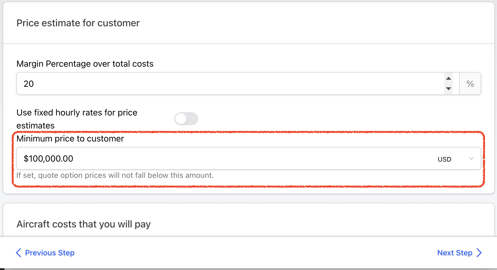

# 🆕 Costings

The Costings section defines how AeroQuote calculates prices for this aircraft. Configure hourly rates, minimum charges, and pricing rules here.

***

## Accessing Costings

1. Go to **Aircraft** from the sidebar
2. Click on an aircraft
3. Select the **Costings** tab

***

## Suggest costs for me

If you are setting up a new type or refreshing rates, use AI suggestions instead of starting from a blank form:

1. On the **Costings** step, click **Suggest costs for me**
2. Wait while AeroQuote builds suggestions for your aircraft type and region
3. Review the modal — suggested hourly rate and/or margin, plus typical operating costs (fuel, maintenance, crew daily rates, handling, etc., depending on operator vs broker context)
4. Choose **Yes, Apply** to fill rates and add cost lines, or **Skip** to leave costs unchanged

You can edit or delete any applied line afterwards. Suggestions are estimates only — always check them against your own figures.


**Good first pass** — Use suggestions to seed costings quickly, then tune amounts and remove anything that does not apply to your operation.


***

## Pricing Models

AeroQuote supports different pricing strategies:

### Hourly Rate Pricing (legacy)

Charge based on flight time:

| Field                | Description                                |
| -------------------- | ------------------------------------------ |
| **Hourly Rate**      | Base rate per flight hour                  |
| **Positioning Rate** | Rate for empty/ferry flights (often lower) |

### Cost-Plus (Margin) Pricing (recommended)

Calculate costs and add a margin:


Many operators already have profit margins built-in to their aircraft costs such as a hourly Charter rate that include your margin. In this case, we recommend using a zero (0) percent margin so your cost base will be the same as the price the customer receives.


| Field                 | Description          |
| --------------------- | -------------------- |
| **Margin Percentage** | Profit margin to add |

***

## Rate Configuration

### Flight Hour Rates

| Rate Type               | When Applied                  |
| ----------------------- | ----------------------------- |
| **Standard Rate**       | Normal passenger flights      |
| **Positioning Rate**    | Empty legs / ferry flights    |
| **Minimum Flight Time** | Minimum billable time per leg |

### Example

If your standard rate is $2,500/hour and minimum is 1 hour:

* A 30-minute flight bills as 1 hour = $2,500
* A 2-hour flight bills as 2 hours = $5,000

***

## Aircraft Costs (Your direct Costs)

Add recurring costs that are automatically calculated on every quote for this aircraft. These are configured in the **Aircraft costs that you will pay** section.

Each cost has a **type** that determines how it's calculated (per hour, per sector, per passenger, per distance, daily, overnight, or ground time) and a **rule** that controls which flights it applies to (all sectors, charter only, or ferry only).


See [Cost Types](cost-types.md) for a detailed explanation of each cost type, how it's calculated, and when to use it.


***

## Airport Charges (Movement Charges)

AeroQuote can add published airport charges (also called landing or movement charges) to your quotes automatically. This is set **per aircraft** on the **Costings** step and is **off by default**.

<!-- TODO: add screenshot of the "Automatically calculate airport charges" switch and default charge fields on the Costings step -->

### Automatically calculate airport charges

Turn on **Automatically calculate airport charges** to have AeroQuote add the published charges for each airport on the itinerary, where we hold them:

* **Landing / movement charges**
* **Passenger charges**
* **Parking charges**

How the charges are applied:

* **Departing charges** are applied at the departure airport, and **arriving charges** at the arrival airport
* Where an airport publishes a business or general aviation (GA) rate, that rate is used
* Each charge appears as its own explanation line in the quote, so you can see exactly what has been added


**Not available on all airports.** Coverage currently includes airports in **Australia** and the **United Kingdom**, and we're adding more. Costs are checked and updated monthly.


### Default airport arrival and departure charges

When the switch is on, two optional fields appear underneath it:

| Field                                | When it applies                                                    |
| ------------------------------------ | ------------------------------------------------------------------ |
| **Default airport arrival charge**   | Charged at the arrival airport                                     |
| **Default airport departure charge** | Charged at the departure airport                                   |

These defaults are only used when an airport has **no airport charge records at all** and you have **no custom charge** for that field at that airport. They're a handy fallback for smaller strips that aren't in our database yet.

In the quote they appear as **Default airport arrival charge $xxx** and **Default airport departure charge $xxx**. Leave a field blank or enter 0 and nothing is charged.


**Negotiated rates?** Use a [Custom Airport Movement Charge](../custom-items/custom-airport-movement-charges.md) to set your own landing, departure, parking or passenger charges at a specific airport. Custom charges apply even when the automatic switch is off.


***

## Minimum Customer Price

Set a **floor price** for this aircraft to ensure quotes never fall below a minimum amount, regardless of how the price is calculated.

| Field                      | Description                                            |
| -------------------------- | ------------------------------------------------------ |
| **Minimum Customer Price** | The lowest price that will be quoted for this aircraft |

When a quote is generated and the calculated price (whether from hourly rates or margin-based pricing) is below the minimum, the quoted price is automatically raised to the minimum amount.

<figure><figcaption></figcaption></figure>


Leave this field empty to disable the minimum. A value of zero is treated as "not set".



**Use this for short flights** — If your shortest possible flight still costs a minimum amount to operate (crew callout, fuel, handling), set a minimum customer price to ensure you don't quote below your break-even.


***

## Currency

Set the currency for this aircraft's pricing:

* Prices are quoted in this currency
* AeroQuote can convert for international quotes if configured

***

## How Costs Calculate

For a typical quote, AeroQuote calculates:

1. **Flight time** × Hourly rate
2. **+ Positioning costs** (if needed)
3. **+ Fuel costs** (based on performance data)
4. **+ Airport movement/landing charges** (automatic airport charges, your custom airport movement charges, or your aircraft defaults — see [Airport Charges](#airport-charges-movement-charges))
5. **+ Additional charges** (overnight, etc.)
6. **= Total quote cost**

***

## Tips


**Know your costs** — Understanding your true operating costs ensures you set profitable rates.


* Review competitor pricing in your market
* Consider different rates for different trip types
* Update rates when fuel costs change significantly
* Use the Cost Simulator to verify your pricing

***

## Next Steps

* [Cost Types](cost-types.md) — Detailed guide to each cost type and when to use it
* [Custom Airport Movement Charges](../custom-items/custom-airport-movement-charges.md) — Set your own charges at specific airports
* [Cost Simulator](cost-simulator.md) — Test your pricing configuration
* [Flight Performance](flight-performance.md) — Verify performance data
