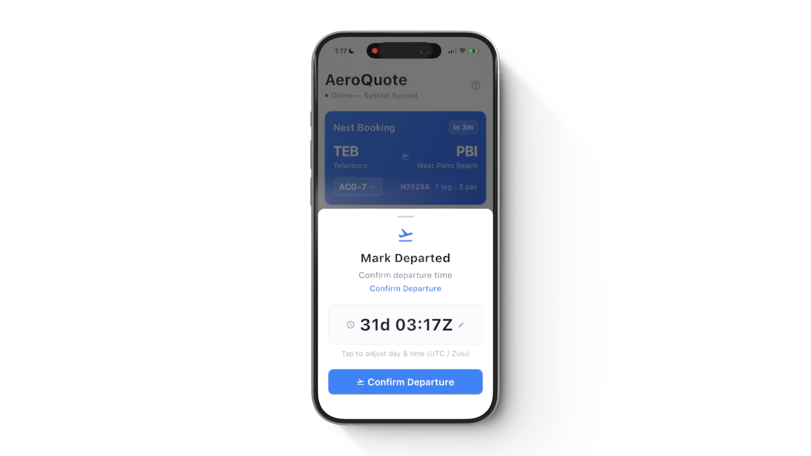

# Flight Status

Record flight departures and arrivals from the mobile app — either by confirming automated flight tracking notifications or by manually entering times.

<figure><figcaption></figcaption></figure>

## How It Works

AeroQuote integrates with flight tracking providers (FlightRadar24 and FlightAware) to automatically detect when your aircraft departs and arrives. When a flight event is detected:

1. All crew assigned to that flight leg receive a **push notification**
2. Tapping the notification opens a **confirmation sheet** pre-filled with the detected time
3. Crew can accept the time as-is or adjust it before confirming

Crew-entered times override FlightAware and Flightradar24 for that flight, and are not overwritten by later tracking updates. Crew can also go back and edit a time they already entered on the same live booking leg.


If a notification arrives while the app is open, the confirmation sheet appears automatically — no need to tap the notification.


## Flight Timeline

The Flight Detail screen shows these times in sequence:

1. **Off Block** — Engine start or push-back, when the aircraft leaves the parking position
2. **Departure** — When the aircraft takes off
3. **ETA** — Estimated arrival, while the flight is airborne (with a source label when one is available)
4. **Arrival** — When the aircraft lands
5. **On Block** — Engine shutdown, when the aircraft reaches the parking position

Until the flight has departed, **Adjust ETD** is also available. Each event has a button that shows the recorded time once confirmed. Tap a button to record it (**Record Off Block**, **Mark Departed**, **Mark Arrived**, **Record On Block**) or, if it is already set, to edit it (**Edit Off Block**, **Edit Departure**, **Edit Arrival**, **Edit On Block**).

## Confirming a Departure

1. Receive a **departure notification** from the flight tracking provider
2. Tap the notification (or view the sheet if the app is open)
3. The bottom sheet shows:
   * The flight route (e.g. YBBN → YSSY)
   * A **UTC/Local toggle** — switch between Zulu time and the airport's local timezone
   * A time picker pre-filled with the detected departure time
   * Adjust the time if the actual departure differs
4. Tap **Confirm Departure**
5. The departure button turns green to indicate it has been recorded

## Confirming an Arrival

1. Receive an **arrival notification** when the tracking provider detects the landing
2. Follow the same flow — confirm or adjust the arrival time
3. Both buttons now show green, indicating the flight is complete

## Manual Entry

If flight tracking doesn't detect a flight (e.g. remote airstrips, VFR flights without ADS-B coverage), you can record times manually:

1. On the Flight Detail screen, scroll to the **Flight Status** section
2. Tap **Off Block** to record engine start or push-back (optional), then **Confirm Off Block**
3. Tap **Departure** and **Confirm Departure**
4. After departure is recorded, **Arrival** becomes active — tap and **Confirm Arrival** when landed
5. Tap **On Block** to record engine shutdown (optional), then **Confirm On Block**


Crew-entered times take priority over tracking data. Once you confirm a time, FlightAware and Flightradar24 will not overwrite it. You can still edit it yourself on the same live booking leg.


Recording **On Block** counts towards the aircraft's maintenance totals (if the aircraft has a baseline) and marks the flight's hours as confirmed. The office does not need to confirm those hours again in Flight Logs. See [Confirmed and pending hours](../aircraft/maintenance-tracker.md#confirmed-and-pending-hours).

Crew cannot edit older **Flight Log** entries (recorded flights that are not the live booking leg) in the app. Ask operations to correct those on the web with aircraft edit permission.

## Adjust ETD

Before a flight begins, crew can adjust the estimated departure time (ETD):

1. On the Flight Detail screen, scroll to the **Flight Status** section
2. Tap the **Adjust ETD** button
3. A time picker appears pre-filled with the current scheduled departure time
4. Adjust the time and tap **Confirm ETD**

The new departure time updates the flight schedule — the arrival time shifts accordingly based on the planned flight duration. The booking's start and end times are also recalculated.


The **Adjust ETD** button disappears once the flight is in progress (**Off Block** or **Departure** recorded). **ETD** can only be changed before the flight has departed. To change an ETD already set, the sheet is titled **Edit ETD**.


## Live Time Remaining

While a flight is in progress, the app shows a **live countdown** to the estimated arrival:

* On the **Booking Detail** screen, each in-flight leg card replaces the planned duration with a live "Xh Ym remaining" countdown and the current ETA
* On the **Flight Detail** screen, the route card and Flight Status section both display the time remaining and ETA with source label (Crew/FA)
* The countdown updates every minute automatically
* If the current time passes the ETA, the display clamps to **"Arriving soon"** rather than showing negative time

The ETA used for the countdown follows this priority: **Crew ETA** > **FlightAware ETA** > **Scheduled arrival time**.

## Log Position

While a flight is in progress, crew can report their current GPS position:

1. Tap the **Log Position** button on the Flight Detail screen
2. The app reads the device's GPS coordinates
3. The position is queued and sent to the server

This is useful for flights without ADS-B coverage where the operator needs to track progress. Positions appear on the booking's live map in the web application.


The Log Position and Update ETA buttons are hidden once a flight is marked as arrived — they are only available during active flights.


## Update ETA

Crew can manually update the estimated arrival time during a flight:

1. Tap the **Update ETA** button on the Flight Detail screen
2. A time picker appears pre-filled with the current ETA
3. Adjust the time and confirm

The ETA source is shown on the dashboard hero card:

* **External ETA** — Estimated by a flight tracking provider (e.g. FlightRadar24)
* **FA ETA** — Estimated by FlightAware
* **Crew ETA** — Manually set by crew via the app

Crew-set ETAs take priority over automated tracking ETAs.

## Offline Support

All flight status operations work offline:

* **Off Block**, **On Block**, **Departure**, **Arrival**, **ETA** updates, **ETD** adjustments, and position logs are all saved locally and queued for sync
* A pending indicator shows until the update reaches the server
* Updates sync automatically when connectivity is restored
* Failed syncs are retried with exponential backoff


You never need to wait for a network connection to record flight events. All operations update the UI instantly and sync in the background.


## Live Flights Dashboard

Flight status updates from the mobile app feed directly into the **Flights Dashboard** — a real-time ops display designed for TV screens and wall monitors. When a departure or arrival is confirmed:

* The flight appears on the **live map** with the actual track
* The **activity feed** shows the departure/arrival event in real time
* Booking cards update with actual times
* Multi-leg bookings transition to **Ground Time** status between legs

See the [Flights Dashboard](../bookings-operators/bookings-dashboard.md) and [Flight Tracking](../bookings-operators/flight-tracking/) guides for more information.
